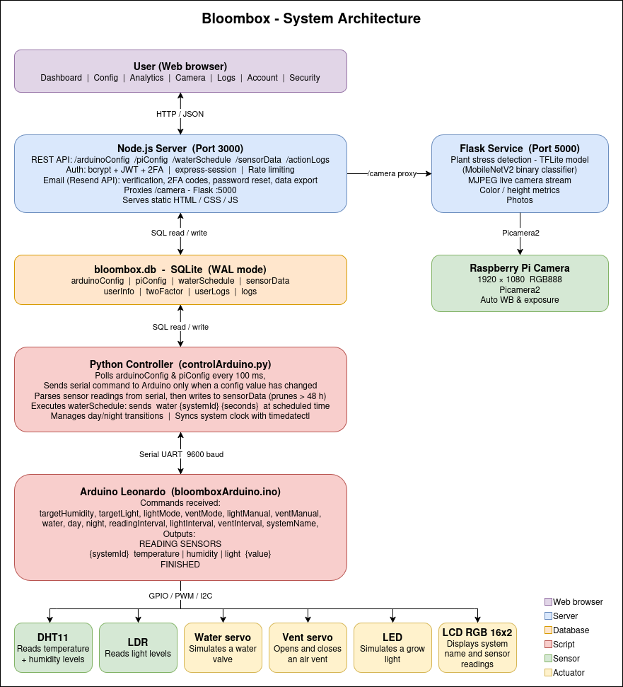

# BloomBox Documentation

BloomBox is a smart greenhouse IoT system. A Node.js web server lets users configure and monitor up to three independent growing systems. A Python script running on the Raspberry Pi reads that configuration from a shared SQLite database and sends commands to an Arduino over serial. The Arduino controls LEDs, servos, and a DHT11 sensor for each system in real time.

---

## System Architecture



## Folder and File Structure

```
bloombox/
├── bloomboxArduino.ino
│   ├── bloomboxArduino.ino     # Arduino firmware (C++) — sensor reading, actuator control, serial protocol
│   └── libraries/              # Arduino libraries
├── src/
│   ├── server/
│   │   └── server.js           # Node.js/Express REST API and static file server (port 3000)
│   └── public/
│       ├── index.html          # Landing page
│       ├── login.html          # Login page
│       ├── register.html       # Registration page
│       ├── forgotPassword.html # Forgot-password flow
│       ├── resetPassword.html  # Password-reset link landing page
│       ├── two-factor.html     # Two-factor / email verification page
│       ├── dashboard.html      # Live dashboard
│       ├── dashboard-script.js # Dashboard JS — polls /api/sensor-data and renders system cards
│       ├── dashboard.css
│       ├── analytics.html      # Historical sensor analytics
│       ├── analytics-script.js # Analytics JS — date-range queries and Chart.js graphs
│       ├── analytics.css
│       ├── config.html         # Per-system configuration (lighting, vents, watering schedule)
│       ├── config-script.js    # Config JS — manages systemState cache and saves to /api/config
│       ├── config-advanced.html# Advanced settings (network, clock, intervals)
│       ├── config.css
│       ├── camera.html         # Live camera feed page
│       ├── camera.js
│       ├── camera.css
│       ├── logs.html           # Serial action log viewer
│       ├── logs.js
│       ├── logs.css
│       ├── account.html        # Account details page
│       ├── settings.html       # User settings
│       ├── preferences.html    # UI preferences
│       ├── preferences.js
│       ├── security.html       # Security settings (password change, 2FA)
│       ├── privacyPolicy.html  # Privacy policy
│       ├── privacypolicy.css
│       ├── script.js           # Shared JS utilities (auth guards, nav)
│       ├── style.css           # Global stylesheet
│       ├── assets/             # UI icon PNGs (dashboard, humidity, light, etc.)
│       └── images/             # BloomBox branding images
├── controlArduino.py           # Raspberry Pi controller — polls DB, drives Arduino over serial
├── manageNetwork.py            # Raspberry Pi network manager — WiFi / hotspot switching via nmcli
├── camera.py                   # Raspberry Pi camera script — captures frames and serves them
├── model.py                    # TFLite plant-stress inference helper
├── plant_stress_model.tflite   # TensorFlow Lite model for plant stress classification
├── bloombox.db                 # SQLite database (shared by server.js and Python scripts)
├── requirements.txt            # Python dependencies
├── package.json                # Node.js dependencies
├── secrets.env                 # API keys and secrets — NOT committed (see Configuration)
└── README.md
```

---

## Setup Instructions

### Prerequisites

| Component | Requirement |
|---|---|
| Node.js | v20 or above — [download](https://nodejs.org/en) / [install guide](https://youtu.be/7pbQ4ZKPBiU) |
| Python | 3.9 or above |
| Arduino IDE | 2.x — [download](https://www.arduino.cc/en/software) |
| Arduino board | Arduino Leonardo (or compatible) |
| Raspberry Pi OS | Bookworm or newer (for network management) |

### Installation

**Web server (Node.js)**

```bash
# From the project root
npm ci
```

If `npm ci` fails, try:

```bash
npm install
```

This installs all dependencies listed in `package.json`. The resulting `node_modules/` directory is gitignored and must not be committed.

**Raspberry Pi scripts (Python)**

```bash
pip install -r requirements.txt
```

**Arduino firmware**

1. Open `bloomboxArduino/bloomboxArduino.ino` in the Arduino IDE.
2. Install the following libraries via **Tools -> Manage Libraries** - or copy the library folders given in this repo to your Arduino IDE libraries folder:
   - `Servo` (built-in)
   - `DHT sensor library` by Adafruit
   - `Adafruit Unified Sensor` by Adafruit
   - `Grove - LCD RGB Backlight` by Seeed Studio
3. Select **Board → Arduino Leonardo** and the correct port.
4. Click **Upload**.


### Camera Setup
1. Connect the camera module into the Pi and then turn it on.
2. Ensure legacy camera is disabled by running:

```bash
sudo raspi-config
```

3. Navigate to Interface Options
4. Select Legacy Camera
5. Select No to disable it
6. Reboot
7. Test the camera using the following command:

```bash
libcamera-hello
```

8. Install the required libraries by running the following commands in the project root folder

```bash
sudo apt update
sudo apt install -y python3-opencv python3-picamera2 libopenblas0
```

9. Before running the Python code, replace the hard-coded Raspberry Pi IP addresses with your Pi's IP. The locations are marked with comments in `camera.py`.

10. Run the python file using the following command (keep in mind that you will need to run the server for the web app to see the camera features in action.)

python3 camera.py

### Configuration

This project uses a `secrets.env` file in the project root to store sensitive values. This file is listed in `.gitignore` and must never be committed. Create it manually with the following keys:

```env
resendApiKey=your_resend_api_key_here
JWTSecret=your_jwt_secret_here
sessionSecret=your_session_secret_here
```

| Variable | Purpose |
|---|---|
| `resendApiKey` | API key for the [Resend](https://resend.com) email service — used for verification and password-reset emails |
| `JWTSecret` | Secret used to sign and verify email-verification and password-reset JWT tokens |
| `sessionSecret` | Secret used to sign Express session cookies |

---

## Running the Project

### Web server

```bash
node src/server/server.js
```

Expected output:

```
[dotenv@17.3.1] injecting env (2) from secrets.env
C:\...\src\public
Server is online! and listening on port 3000
```

Open `http://localhost:3000` in a browser to access the web UI.

### Raspberry Pi controller

```bash
python3 controlArduino.py
```

The script auto-detects the Arduino on the serial port and creates `bloombox.db` if it does not already exist. It then polls the database every `updateInterval` milliseconds and sends any changed config values to the Arduino.

### Raspberry Pi network manager

```bash
python3 manageNetwork.py
```

Reads `piConfig` from the database and uses `nmcli` to join a configured WiFi network or fall back to a **Bloombox** hotspot.

### Camera script

```bash
python3 camera.py
```

Captures frames from the connected camera and makes them available to the web server for the live feed.

---

## Third-Party Software and Frameworks

### Node.js (server)

| Package | Version | Purpose | Documentation |
|---|---|---|---|
| `express` | ^5.2.1 | HTTP server and routing framework | [expressjs.com](https://expressjs.com) |
| `better-sqlite3` | ^12.6.2 | Synchronous SQLite3 bindings for Node.js | [github.com/WiseLibs/better-sqlite3](https://github.com/WiseLibs/better-sqlite3) |
| `bcrypt` | ^6.0.0 | Password hashing with bcrypt | [github.com/kelektiv/node.bcrypt.js](https://github.com/kelektiv/node.bcrypt.js) |
| `express-session` | ^1.19.0 | Session middleware for Express | [github.com/expressjs/session](https://github.com/expressjs/session) |
| `express-rate-limit` | ^8.4.1 | Rate-limiting middleware to protect auth endpoints | [github.com/express-rate-limit/express-rate-limit](https://github.com/express-rate-limit/express-rate-limit) |
| `jsonwebtoken` | ^9.0.3 | JWT creation and verification for email links | [github.com/auth0/node-jsonwebtoken](https://github.com/auth0/node-jsonwebtoken) |
| `resend` | ^6.9.3 | Email delivery API (verification, password reset) | [resend.com/docs](https://resend.com/docs) |
| `nodemailer` | ^8.0.2 | Fallback SMTP email transport | [nodemailer.com](https://nodemailer.com) |
| `dotenv` | ^17.3.1 | Loads `secrets.env` into `process.env` | [github.com/motdotla/dotenv](https://github.com/motdotla/dotenv) |
| `chart.js` | ^4.5.1 | Client-side charting library (sensor graphs) | [chartjs.org](https://www.chartjs.org) |
| `marked` | ^18.0.3 | Markdown-to-HTML renderer | [marked.js.org](https://marked.js.org) |
| `path` | ^0.12.7 | Node.js path utilities (polyfill) | [nodejs.org/api/path](https://nodejs.org/api/path.html) |
| `crypto` | ^1.0.1 | Cryptographic utilities (polyfill) | [nodejs.org/api/crypto](https://nodejs.org/api/crypto.html) |

### Python (Raspberry Pi)

| Package | Version | Purpose | Documentation |
|---|---|---|---|
| `pyserial` | 3.5 | Serial communication with the Arduino | [pyserial.readthedocs.io](https://pyserial.readthedocs.io) |
| `iso8601` | 2.1.0 | ISO 8601 date/time parsing | [pypi.org/project/iso8601](https://pypi.org/project/iso8601/) |
| `PyYAML` | 6.0.3 | YAML parsing utility | [pyyaml.org](https://pyyaml.org) |
| `future` | 1.0.0 | Python 2/3 compatibility shim | [python-future.org](https://python-future.org) |
| `Flask` | 3.1.0 | Lightweight Python web framework for the API server | [flask.palletsprojects.com](https://flask.palletsprojects.com/) |
| `Flask-CORS` | 5.0.0 | Cross-Origin Resource Sharing support for Flask APIs | [flask-cors.readthedocs.io](https://flask-cors.readthedocs.io/) |
| `NumPy` | 2.2.5 | Numerical computing and array operations | [numpy.org/doc](https://numpy.org/doc/) |
| `OpenCV` | 4.11.0 | Computer vision and image processing library | [docs.opencv.org](https://docs.opencv.org/) |
| `Picamera2` | 0.3.27 | Raspberry Pi camera interface library | [datasheets.raspberrypi.com/camera/picamera2-manual.pdf](https://datasheets.raspberrypi.com/camera/picamera2-manual.pdf) |
| `TensorFlow Lite` | 2.16.1 | Lightweight machine learning inference framework | [tensorflow.org/lite](https://www.tensorflow.org/lite) | 


### Arduino libraries

| Library | Purpose | Documentation |
|---|---|---|
| `Servo` | Controls water valve and vent servos | [arduino.cc/reference/en/libraries/servo](https://www.arduino.cc/reference/en/libraries/servo/) |
| `DHT sensor library` by Adafruit | Reads temperature and humidity from DHT11 | [github.com/adafruit/DHT-sensor-library](https://github.com/adafruit/DHT-sensor-library) |
| `Adafruit Unified Sensor` | Abstraction layer required by the DHT library | [github.com/adafruit/Adafruit_Sensor](https://github.com/adafruit/Adafruit_Sensor) |
| `Grove - LCD RGB Backlight` by Seeed Studio | Drives the Grove I2C LCD display | [wiki.seeedstudio.com/Grove-LCD_RGB_Backlight](https://wiki.seeedstudio.com/Grove-LCD_RGB_Backlight/) |

---

## Code Documentation

- **`src/server/server.js`** — inline comments above each route group explain the purpose and auth requirements of each endpoint.
- **`controlArduino.py`** — docstrings on the main loop and helper functions explain the DB-to-serial flow.
- **`manageNetwork.py`** — inline comments explain each network state transition.
- **`bloomboxArduino.ino`** — comments at the top of the file describe the pin array convention. Each function has an inline comment explanation.

---

## Hardware Setup

### Devices

All sensors and actuators are grouped into systems. Each system index controls one of each device type.

| Component | Pin |
|---|---|
| LDR light sensor | `A0` |
| LED | `6` |
| DHT11 temp/humidity sensor | `7` |
| Air vent servo | `5` |
| Water valve servo | `4` |
| Grove LCD RGB Backlight | I2C |

To add more systems, extend the pin arrays in `bloomboxArduino.ino`. Unused slots are set to `-1` as a placeholder (the code will skip those pins automatically).

### Servo Positions

| Position | Value |
|---|---|
| Closed (water servo) | 90° |
| Open (water servo) | 180° |
| Closed (vent servo) | 30° |
| Open (vent servo) | 117° |

### Python Setup

Run the Arduino controller:
   ```bash
   python3 controlArduino.py
   ```

   The script will automatically detect the Arduino on the serial port and create a `bloombox.db` SQLite database if one does not already exist.

---

## Camera

The camera's functionality is built into one component but uses a component made in another file:

*camera.py*
Runs on the Raspberry Pi and acts as a Flask API that captures plant images, outputs a live camera stream, plant colour analysis, droop estimation and detects stress in plants using a TensorFlow Lite model. This is used in conjunction with the web app.

*model.py*
When run, this outputs a TensorFlow model to predict plant stress. This model is trained on healthy and stressed images. These images were retrieved from the PlantVillage dataset on Kaggle.

*tf_to_tflite_converter.py*
This converts the TensorFlow model outputted by model.py to a TensorFlow Lite model

## API Endpoints
- /predict
Captures images and predicts the health of the plant using the function predict_stress_percentage(). Calculates how green and yellow a plant is using the function color_metrics(). Calculates the height of the plant using the function plant_height_percent().

- /stream
Provides a live camera stream to the web app

- /comparison
Compares the latest scan with a scan from ~7 days ago

-/photos/<filename>
To retrieve saved photos

## How the System Works
1. Camera captures the frame
2. Frame is
   - Resized to 224x224
   - Passed to the TensorFlow Lite model
3. Additional metrics computed:
   - Green pixel percentage
   - Yellow pixel percentage
   - Droop percentage
4. Image saved locally and are deleted after 7 days
5. Data stored in JSON history
6. Results sent to frontend

---

## Networking (Raspberry Pi)

The greenhouse can either join your home WiFi (and stay reachable on the LAN at `http://bloombox.local:3000`) or fall back to its own **Bloombox** hotspot if no WiFi is configured / it can't connect. The Network card on the *Advanced Settings* page in the web UI manages this.

This is handled by `manageNetwork.py`, which polls `piConfig` and uses NetworkManager (`nmcli`). It is intended for **Raspberry Pi OS Bookworm or newer**.

### One-time Pi setup

1. Set the hostname so phones/laptops can reach the Pi at `bloombox.local`:
   ```bash
   sudo hostnamectl set-hostname bloombox
   sudo systemctl enable --now avahi-daemon
   ```

2. Allow the user running the script to call `nmcli` without a password. Add this with `sudo visudo`:
   ```
   <user> ALL=(ALL) NOPASSWD: /usr/bin/nmcli
   ```
   (replace `<user>` with the account you run `manageNetwork.py` as).

3. Install the Bloombox scripts as systemd services so they run on boot.

### How it behaves

- On first boot (no `wifiSsid` saved) the Pi runs the **Bloombox** hotspot using the password stored in `piConfig.hotspotPassword` (defaults to `bloombox123`).
- Once you save a WiFi SSID + password in the web UI, the Pi attempts to join. On success, the hotspot is taken down and the Pi is reachable at `bloombox.local:3000`.
- If the join fails within 30 seconds, the hotspot is automatically restarted as a fallback so you can fix the credentials.
- Status is reflected in `piConfig.networkStatus` (`connecting:<ssid>`, `connected:<ssid>`, `hotspot`, `hotspot-fallback:<ssid>`, …) and shown live on the Network card.

---

## Running on Boot (systemd)

On the Raspberry Pi, the four Bloombox processes — Arduino controller, network manager, camera, and the Node.js web server — are run as systemd services so they start on boot and restart on failure. The examples below assume the project lives at `/home/bloombox/bloombox` and runs as the `bloombox` user; adjust the paths and `User=` line if your setup differs.

### 1. Create the unit files

Create each unit file with `sudo nano /etc/systemd/system/<name>.service`:

**`/etc/systemd/system/arduinoapp.service`**
```ini
[Unit]
Description=Arduino controller
After=network.target

[Service]
ExecStart=/usr/bin/python3 /home/bloombox/bloombox/controlArduino.py
WorkingDirectory=/home/bloombox/bloombox
StandardOutput=journal
StandardError=journal
Restart=always
User=bloombox

[Install]
WantedBy=multi-user.target
```

**`/etc/systemd/system/networkapp.service`**
```ini
[Unit]
Description=Network manager Script
After=network.target

[Service]
ExecStart=/usr/bin/python3 /home/bloombox/bloombox/manageNetwork.py
WorkingDirectory=/home/bloombox/bloombox
StandardOutput=journal
StandardError=journal
Restart=always
User=bloombox

[Install]
WantedBy=multi-user.target
```

**`/etc/systemd/system/camapp.service`**
```ini
[Unit]
Description=Camera script
After=network.target

[Service]
ExecStart=/usr/bin/python3 /home/bloombox/bloombox/camera.py
WorkingDirectory=/home/bloombox/bloombox
StandardOutput=journal
StandardError=journal
Restart=always
User=bloombox

[Install]
WantedBy=multi-user.target
```

**`/etc/systemd/system/nodeapp.service`**
```ini
[Unit]
Description=Node.js Server
After=network.target

[Service]
ExecStart=/usr/bin/node /home/bloombox/bloombox/src/server/server.js
WorkingDirectory=/home/bloombox/bloombox
StandardOutput=journal
StandardError=journal
Restart=always
User=bloombox
Environment=NODE_ENV=production

[Install]
WantedBy=multi-user.target
```

### 2. Enable and start the services

```bash
sudo systemctl daemon-reload
sudo systemctl enable networkapp.service arduinoapp.service camapp.service nodeapp.service
sudo systemctl start networkapp.service arduinoapp.service camapp.service nodeapp.service
```

### 3. Useful commands

```bash
sudo systemctl status arduinoapp.service     # check whether a service is running
sudo journalctl -u arduinoapp.service -f     # see the live logs for a service
sudo systemctl restart arduinoapp.service    # restart after pulling new code
sudo systemctl disable arduinoapp.service    # stop it from running at boot
```

Replace `arduinoapp` with `networkapp`, `camapp`, or `nodeapp` as needed.

---

## Database Schema

**`piConfig`** — Configuration for the Python script. Single-key (`setting` is the primary key). Written to by both `controlArduino.py` and `manageNetwork.py`.

| Setting | Default | Description |
|---|---|---|
| `updateInterval` | `1000` | How often the database is polled and config/schedule dicts are updated (milliseconds) |
| `clockMode` | `auto` | `auto` syncs the Pi clock with NTP; `manual` sets it to `manualTime` once with `timedatectl` |
| `manualTime` | `12:00` | Time of day applied when `clockMode` is `manual` (HH:MM) |
| `wifiSsid` | `""` | SSID of the home WiFi for the Pi to join. If empty, Pi runs the Bloombox hotspot |
| `wifiPassword` | `""` | Password for the home WiFi |
| `hotspotPassword` | `bloombox123` | Password for the fallback Bloombox hotspot (8–63 chars, WPA2) |
| `networkStatus` | `starting` | Written by `manageNetwork.py` to reflect the current network state |

**`arduinoConfig`** — Configuration sent to the Arduino. Primary key is `(setting, systemId)`. `systemId` is `0` for global settings.

| Setting | systemId | Description |
|---|---|---|
| `systemCount` | `0` | Number of active systems |
| `readingInterval` | `0` | Sensor reading interval (seconds) |
| `lightInterval` | `0` | Lighting adjustment interval (milliseconds) |
| `ventInterval` | `0` | Ventilation adjustment interval (milliseconds) |
| `systemName` | `1–3` | Display name for each system |
| `targetHumidity` | `1–3` | Target humidity (%) for each system in auto vent mode |
| `targetLight` | `1–3` | Target light level (lux) for each system in auto light mode |
| `ventMode` | `1–3` | Ventilation mode: `auto` or `manual` |
| `lightMode` | `1–3` | Lighting mode: `auto` or `manual` |
| `ventManual` | `1–3` | Manual vent open percentage (0–100%) |
| `lightManual` | `1–3` | Manual LED brightness percentage (0–100%) |
| `dayTime` | `1–3` | Per-system day-start time (HH:MM) |
| `nightTime` | `1–3` | Per-system night-start time (HH:MM) |

**`waterSchedule`** — Automatic watering events. Composite primary key `(time, systemId)`.

| Column | Type | Description |
|---|---|---|
| `time` | TEXT | Time of day to water (HH:MM) |
| `systemId` | INTEGER | System to water (starts from 1) |
| `amount` | INTEGER | Duration in seconds to open the valve |

**`sensorData`** — Log of all sensor readings. Pruned to the last 24 hours by `controlArduino.py` on each poll.

| Column | Type | Description |
|---|---|---|
| `timeStamp` | TEXT | Date and time of the reading |
| `systemId` | INTEGER | System the reading came from (starts from 1) |
| `sensorType` | TEXT | `temperature`, `humidity`, or `light` |
| `sensorValue` | FLOAT | The sensor reading value |

**`logs`** — Append-only record of serial traffic received from the Arduino. Written by `controlArduino.py` for debugging.

| Column | Type | Description |
|---|---|---|
| `timeStamp` | TEXT | Date and time the line was received |
| `log` | TEXT | The serial line, verbatim |

---

## Serial Command Reference

| Command | Description |
|---|---|
| `day` | Disable night mode (enables lights and sensors) |
| `night` | Enable night mode (disables lights and sensors) |
| `systemCount <n>` | Set the number of active systems (1–3) |
| `systemName <id> <name>` | Set the display name of a system |
| `water <id> <seconds>` | Open water valve for system `id` for `seconds` seconds |
| `targetLight <id> <lux>` | Set target light level for system `id` (auto mode) |
| `targetHumidity <id> <percent>` | Set target humidity for system `id` (auto mode) |
| `lightMode <id> auto\|manual` | Set lighting mode for system `id` |
| `ventMode <id> auto\|manual` | Set ventilation mode for system `id` |
| `lightManual <id> <percent>` | Set LED brightness manually for system `id` (0–100%) |
| `ventManual <id> <percent>` | Set vent open position manually for system `id` (0–100%) |
| `readingInterval <seconds>` | Set sensor reading interval |
| `lightInterval <ms>` | Set lighting adjustment interval |
| `ventInterval <ms>` | Set ventilation adjustment interval |

All system IDs start from 1.

---

## Automatic Control

### Lighting
In **auto** mode, the Arduino continuously adjusts LED brightness to maintain the target lux level by comparing the light sensor reading to the target. In **manual** mode, the LED is set to a fixed brightness percentage.

### Ventilation
In **auto** mode, the Arduino periodically compares the humidity reading to the target and adjusts the vent servo proportionally to the difference. In **manual** mode, the vent is held at a fixed open percentage.

### Watering
The Python script checks the `waterSchedule` table periodically. When a scheduled time is reached, it sends a `water` command to the Arduino, which opens the valve for the specified duration then closes it automatically.

### Day / Night Mode
The Python script sends `day` and `night` commands based on the per-system `dayTime` and `nightTime` entries in `arduinoConfig`. System 1's window is used as the global source for the Arduino's single day/night flag. Night mode disables lighting and pauses sensor readings.

### LCD Display
The Grove LCD RGB Backlight cycles through each active system, showing the system name, temperature, humidity, and light level from the most recent sensor reading.

---

## Troubleshooting

**Server fails to start — `Cannot find module` or similar**
Run `npm ci` from the project root to reinstall all Node.js dependencies. Make sure you are using Node.js v20 or above (`node --version`).

**Server starts but crashes immediately — `secrets.env not found` or missing key errors**
Ensure `secrets.env` exists in the project root and contains all three required keys (`resendApiKey`, `JWTSecret`, `sessionSecret`). See [Configuration](#configuration).

**`controlArduino.py` cannot find the Arduino (serial port error)**
The script auto-detects the port by scanning for a connected serial device. If it fails, check that the Arduino is plugged in and that you have permission to access the serial port:
```bash
sudo usermod -aG dialout $USER   # Linux — log out and back in after running this
```

**Database is locked (`database is locked` / `SQLITE_BUSY`)**
Both `server.js` and `controlArduino.py` open `bloombox.db` concurrently. Both enable WAL mode, which allows this. If you still see lock errors, check that no other process has opened the file in exclusive mode (e.g. DB Browser for SQLite with the file open and unsaved changes).

**Emails go straight to junk / spam**
This is a known limitation when sending from a shared Resend test domain. If you have a verified custom domain in Resend, update `resendApiKey` accordingly. Ensure the recipient adds the sender address to their contacts.

**`manageNetwork.py` fails — `nmcli: command not found` or permission denied**
This script requires NetworkManager and `nmcli`. Install them on Raspberry Pi OS Bookworm with:
```bash
sudo apt install network-manager
```
Then grant passwordless `nmcli` access via `sudo visudo` as described in [One-time Pi setup](#one-time-pi-setup).

**Arduino sketch won't compile — library not found**
Open the Arduino IDE, go to **Tools -> Manage Libraries**, and install the missing library by name (see [Arduino Setup](#arduino-setup)). The vendored copies in `bloomboxArduino/libraries/` are provided as a fallback; the IDE will pick them up if they are placed in your sketchbook's `libraries/` folder.
